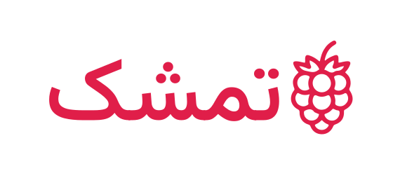
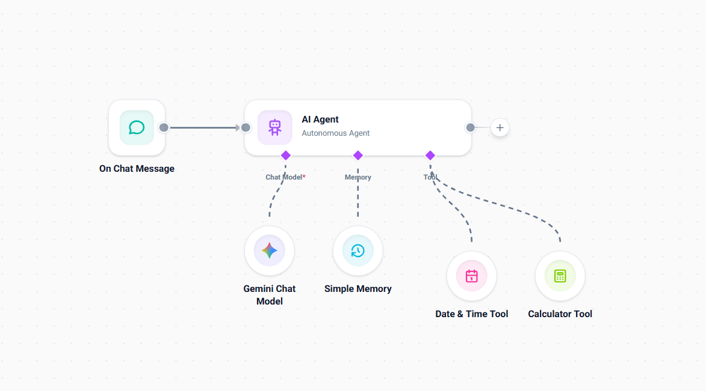
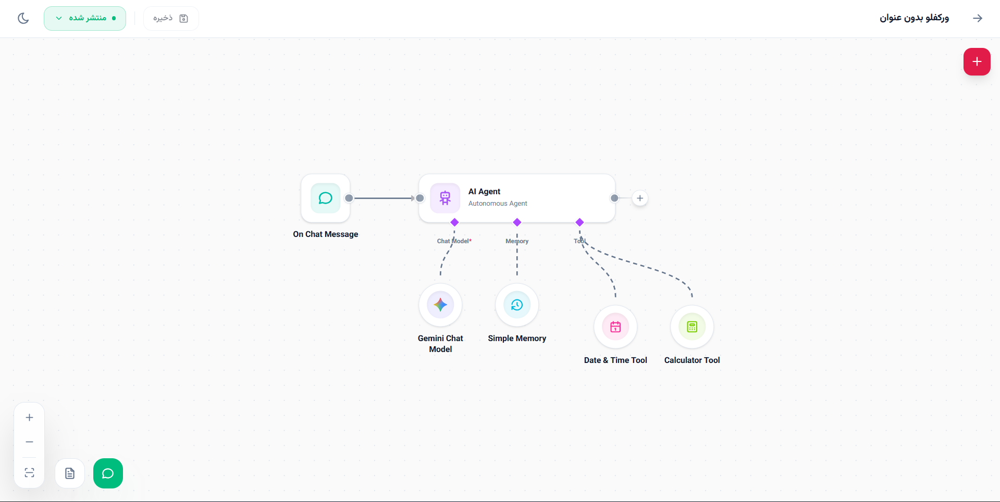
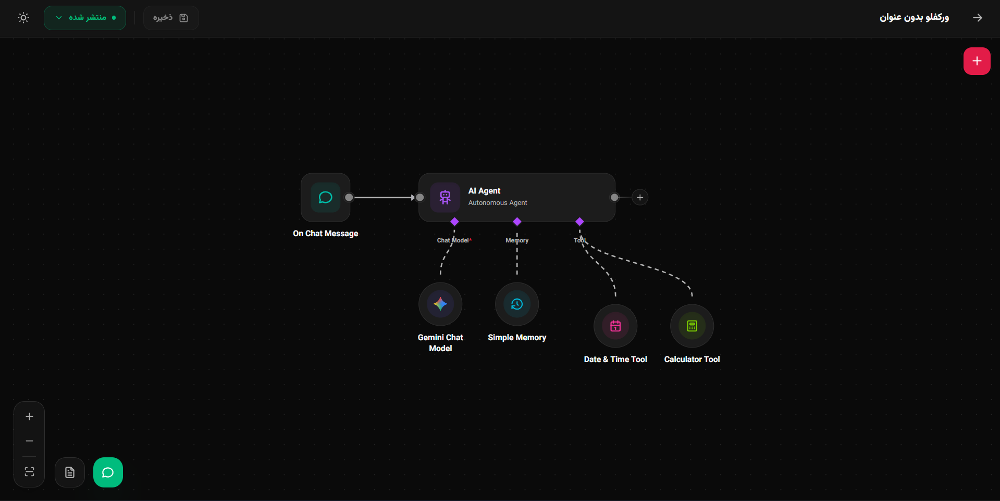

<p align="center">
  
</p>

<p align="center">
  <strong>Tameshk (تمشک)</strong> — a visual workflow automation platform with an AI-ready node canvas.
</p>

<p align="center">
  
  
  
  
  
  
</p>

<p align="center">
  <picture>
    <source media="(prefers-color-scheme: dark)" srcset="docs/screenshots/canvas-dark.png">
    
  </picture>
</p>

---

## Overview

Tameshk lets you design, run, and monitor automations on a drag-and-drop canvas. Connect triggers, logic, and AI-powered nodes into a workflow, test it live, and publish it when it's ready.

The backend is built with **Laravel** and **Livewire**, while the workflow editor is a dedicated **React + TypeScript** single-page canvas embedded in the app.

## Features

- **Visual workflow canvas** — drag, connect, copy/paste, and organize nodes with a context menu and node picker.
- **Triggers & endpoints** — start workflows from configurable triggers.
- **Rich node settings** — conditions editor, key-value editor, multi-select, and model selection fields.
- **Credentials management** — store and reuse credentials securely across nodes.
- **Built-in chat widget** — talk to your workflow directly from the editor.
- **Live execution logs** — inspect runs and node data in a tree viewer.
- **Draft & publish** — save changes safely and publish a workflow when it's ready.
- **Light & dark mode** — the editor follows your color preference.
- **RTL / Persian-first** — localized for Persian (`fa`) with a clean, modern UI.

## Screenshots

| Light | Dark |
| :---: | :---: |
|  |  |

## Tech Stack

| Layer | Technology |
| --- | --- |
| Framework | Laravel 13, PHP 8.5 |
| Reactive UI | Livewire 4 |
| Canvas | React + TypeScript (state via a modular store) |
| Database | MySQL 8.4 |
| Cache / Queue / Session | Redis 8 |
| Mail (local) | Mailpit |
| Environment | Docker via [Laravel Sail](https://laravel.com/docs/sail) |

## Getting Started

Tameshk runs entirely in Docker with **Laravel Sail**, so you don't need PHP, Composer, Node.js, MySQL, or Redis installed on your machine.

### Requirements

- [Docker](https://docs.docker.com/get-docker/) with Docker Compose v2
- Git

### Installation

```bash
# 1. Clone the repository
git clone https://github.com/<your-username>/tameshk.git
cd tameshk

# 2. Configure the environment
cp .env.example .env
```

Edit `.env` and set at least `DB_DATABASE`, `DB_USERNAME`, and `DB_PASSWORD`.

```bash
# 3. Create the external Docker network used by the app container
docker network create global-proxy-network

# 4. Install PHP dependencies (this also installs Sail itself)
docker run --rm \
    -u "$(id -u):$(id -g)" \
    -v "$(pwd):/var/www/html" \
    -w /var/www/html \
    laravelsail/php85-composer:latest \
    composer install --ignore-platform-reqs

# 5. Start all services
./vendor/bin/sail up -d

# 6. Initialize the application
./vendor/bin/sail artisan key:generate
./vendor/bin/sail artisan migrate
./vendor/bin/sail artisan storage:link

# 7. Install and build frontend assets
./vendor/bin/sail npm install
./vendor/bin/sail npm run dev        # development
# ./vendor/bin/sail npm run build    # production
```

> **Tip:** add a shell alias to save typing: `alias sail='[ -f sail ] && sh sail || sh vendor/bin/sail'`

### Services

`sail up -d` starts the following containers:

| Service | Purpose | Local access |
| --- | --- | --- |
| `laravel.test` | Application (PHP 8.5) | via your reverse proxy on `global-proxy-network` |
| `mysql` | MySQL 8.4 database | `127.0.0.1:3307` |
| `redis` | Cache, queue, and sessions | internal |
| `mailpit` | Catches outgoing emails | <http://localhost:8025> |
| `sail-worker` | Queue worker (`queue:work redis`) | internal |
| `sail-scheduler` | Task scheduler (`schedule:work`) | internal |

The queue worker and scheduler run automatically as containers, so there is no need to start them manually.

### Common commands

```bash
./vendor/bin/sail up -d          # start services
./vendor/bin/sail down           # stop services
./vendor/bin/sail artisan ...    # run Artisan commands
./vendor/bin/sail composer ...   # run Composer commands
./vendor/bin/sail npm ...        # run npm commands
./vendor/bin/sail test           # run the test suite
./vendor/bin/sail logs -f sail-worker
```

## Contributing

Contributions, issues, and feature requests are welcome. Please open an issue to discuss major changes before submitting a pull request.

## Security

If you discover a security vulnerability, please report it privately rather than opening a public issue. Never commit `.env` files or real credentials.

## License

Released under the [MIT License](LICENSE) — *(update this to match your chosen license)*.
